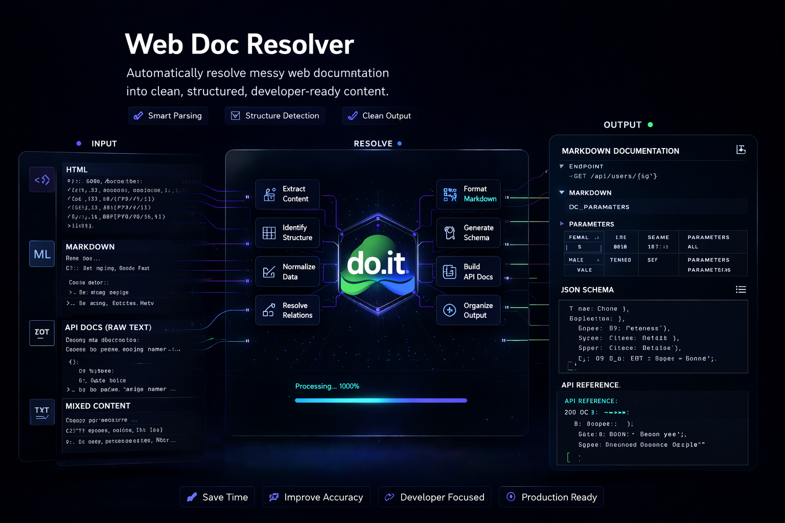

<div align="center">



# do-web-doc-resolver

**Resolve web queries and URLs into compact, LLM-ready Markdown.**

[](https://github.com/d-oit/do-web-doc-resolver/actions)
[](https://www.python.org/)
[](https://www.rust-lang.org/)
[](https://nextjs.org/)
[](LICENSE)

[**Live Demo**](https://web-eight-ivory-29.vercel.app) · [**Documentation**](docs/) · [**Report Bug**](https://github.com/d-oit/do-web-doc-resolver/issues)

</div>

---

## Table of Contents

- [Overview](#overview)
- [What the Cascade Is](#what-the-cascade-is)
  - [Query Cascade Order](#query-cascade-order)
  - [URL Cascade Order](#url-cascade-order)
- [How to Install](#how-to-install)
  - [Python](#python)
  - [Rust CLI (`do-wdr`)](#rust-cli-do-wdr)
  - [Web UI](#web-ui)
- [How to Run](#how-to-run)
  - [Python CLI](#python-cli)
  - [Python Module](#python-module)
  - [Rust CLI (`do-wdr`)](#rust-cli-do-wdr-1)
  - [Web UI](#web-ui-1)
- [Environment Variables Required](#environment-variables-required)
- [How to Run Tests](#how-to-run-tests)
  - [Python Test Suite](#python-test-suite)
  - [Rust Test Suite](#rust-test-suite)
  - [Web UI Playwright Tests](#web-ui-playwright-tests)
  - [Quality Gate Script](#quality-gate-script)

---

## Overview

`do-web-doc-resolver` fetches web pages and executes search queries, stripping HTML boilerplate and returning token-dense Markdown for LLM context windows. It evaluates results against content density and quality thresholds, executing a tiered fallback cascade across free and paid providers.

---

## What the Cascade Is

The resolver queries providers in priority tiers and halts upon receiving a response that satisfies quality scoring thresholds.

### Query Cascade Order

1. **Semantic Cache**: Local SQLite vector cache (`sqlite-vec`).
2. **Free Search Tier**: Exa MCP, Exa SDK, Tavily, DuckDuckGo.
3. **Paid Search Tier**: Serper, Mistral WebSearch.

### URL Cascade Order

1. **Semantic Cache**: Local vector lookup.
2. **Free Static & Lite Tier**: `llms.txt` discovery, Jina Reader, Firecrawl, direct HTTP fetch.
3. **Browser Tier**: Mistral Browser.
4. **Visual Tier**: CLIP-based visual resolution for scanned PDFs and JS-heavy pages.

A routing budget (profiles `free`, `fast`, `balanced`, `quality`) controls how many
attempts are made, whether paid providers may run, and the total latency ceiling;
a quality score decides whether the cascade stops early or falls through to the
next provider. Paid tiers only activate when the matching API key is present.

---

## How to Install

### Python

Requires Python 3.11 or higher (CI runs 3.11-3.13).

```bash
git clone https://github.com/d-oit/do-web-doc-resolver.git
cd do-web-doc-resolver
python -m venv .venv && source .venv/bin/activate
pip install -e ".[dev]"
```

This installs the package with its console entry points (`do-wdr`,
`do-web-doc-resolver`) and the development/test tooling. The published wheel
(`pip install do-web-doc-resolver`) ships only runtime dependencies.

### Rust CLI (`do-wdr`)

Requires Rust 1.85 or higher (the version pinned in CI).

```bash
cd cli
cargo build --release
```

### Web UI

Requires Node.js 22 or higher (the version pinned in CI).

```bash
cd web
npm ci --legacy-peer-deps
```

---

## How to Run

### Python CLI

Pass a target URL or query as the positional argument:

```bash
python -m scripts.cli "https://docs.python.org/3/"
python -m scripts.cli "python asyncio taskgroup example"
```

### Python Module

```python
from scripts.resolve import resolve

result = resolve("https://docs.python.org/3/")
print(result["content"])
```

### Rust CLI (`do-wdr`)

```bash
./cli/target/release/do-wdr resolve "https://docs.python.org/3/"
./cli/target/release/do-wdr resolve "rust tokio tutorial"
```

### Web UI

```bash
cd web
npm run dev
# Open http://localhost:3000
```

---

## Environment Variables Required

Zero-configuration mode runs using free providers without API keys. Optional environment variables enable paid provider tiers:

| Environment Variable | Provider | Required | Description |
|---|---|---|---|
| `EXA_API_KEY` | Exa SDK | No | Enables Exa search and content extraction |
| `TAVILY_API_KEY` | Tavily | No | Enables Tavily web search |
| `SERPER_API_KEY` | Serper | No | Enables Google Search via Serper |
| `FIRECRAWL_API_KEY` | Firecrawl | No | Enables Firecrawl scraping |
| `MISTRAL_API_KEY` | Mistral AI | No | Enables Mistral Search and Mistral Browser |

---

## How to Run Tests

### Python Test Suite

```bash
pytest tests/ -v -m "not live"
```

### Rust Test Suite

```bash
cd cli && cargo test
```

### Web UI Playwright Tests

```bash
cd web && npx playwright test --project=desktop
```

### Quality Gate Script

```bash
./scripts/quality_gate.sh
```

The native verification entry point is the `do-harness` CLI
(`do-harness verify --set verification --strict`, config in `do-harness.toml`);
`quality_gate.sh` is the legacy fallback with equivalent local coverage.
